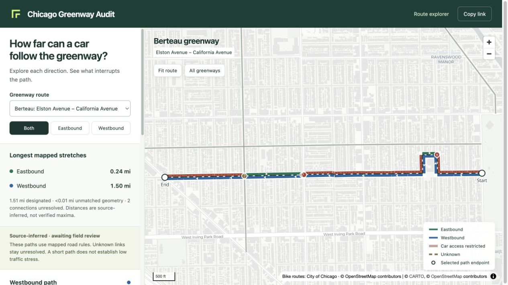
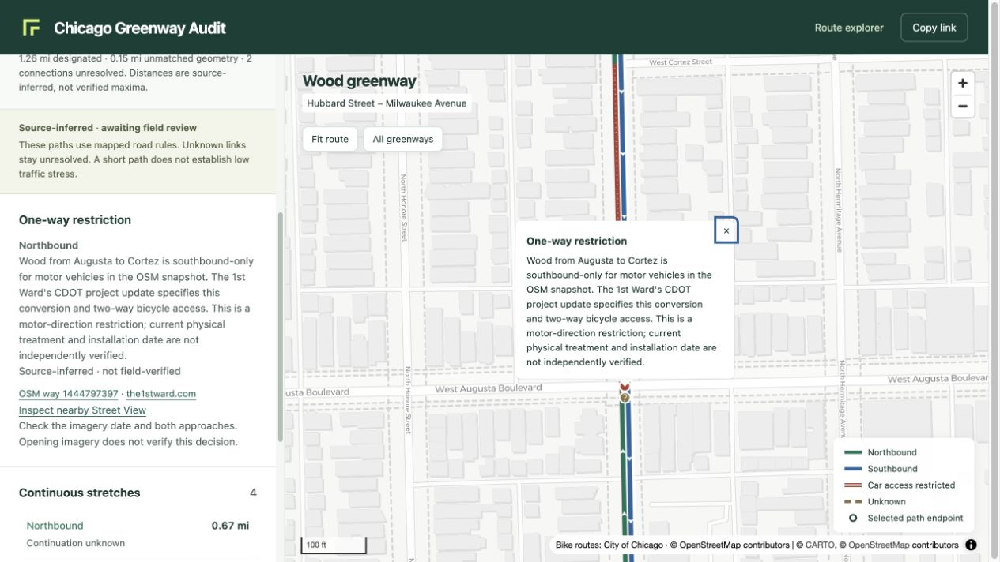

# Chicago Greenway Audit

**How far can a car follow a Chicago neighborhood greenway before it has to leave the route?**

This project maps continuous car access in each direction along CDOT’s designated Neighborhood Greenways. It follows the greenway through turns, shows what interrupts a driving path, and keeps the evidence behind each decision inspectable.

Greenways are intended to offer comfortable bicycle routes. Long, uninterrupted car paths can help identify places to investigate for through traffic. **This map measures potential vehicle access—not traffic volume, speed or cycling stress.** Its results are inferred from saved sources and have not been field verified.

[Get started](#run-it-locally) · [Methodology](docs/methodology.md) · [Development](docs/development.md) · [Documentation](docs/README.md)



*Berteau illustrates why direction and route shape matter: the mapped westbound path follows the Richmond–alley–Sacramento dogleg for about 1.50 miles, while eastbound one-way restrictions interrupt it. Unknown ends are not confirmed maximum driving distances.*

## Run it locally

Use **Node.js 24 or newer** and npm, from the repository root:

```sh
npm ci
npm run dev
```

Open the local URL printed by Vite. The committed data is ready to explore; no database setup, Rust installation, routing server or API key is needed. The basemap loads from CARTO over the internet.

To check the project and preview a production build:

```sh
npm run verify
npm run preview
```

`verify` runs the tests, validates the route export and builds the app. See [Development](docs/development.md) for source-data regeneration and the separate source audit.

## Explore a greenway

1. **Choose a route and direction.** Compare the longest mapped stretch in each direction, or show both.
2. **Select a continuous stretch.** Click its line or list entry to see its full length and why it ends.
3. **Measure from a point.** Click along the selected path or use the position slider to see the remaining distance in that direction.
4. **Inspect an interruption.** Read the reason, source links and review needs. Street View links are a manual investigation aid; opening imagery does not verify a movement.
5. **Share the view.** Copy link preserves the route, direction, selected path or interruption, measurement and map position.

Green and blue distinguish travel directions. They are not low-stress ratings. Red marks restricted car access; dashed brown marks unknown connections.

| Situation | What happens to a car path? |
| --- | --- |
| The designated greenway turns or bends | Continue when the route movement is permitted. |
| Stop sign, traffic signal or speed hump | Continue after the pause; these alone do not break access. |
| One-way restriction, prohibited movement or physical filter | End the affected direction’s path. Bicycle exceptions do not authorize cars. |
| Unmatched road, conflicting sources or unsupported restriction | Stop the asserted path and show uncertainty. Unknown does not mean blocked. |
| The designation ends | End the measurement’s scope. Cars may still be able to continue on the street. |

A car cannot take an off-route detour and rejoin within the same continuous stretch.

## Evidence you can inspect



*On Wood between Augusta and Cortez, the saved OSM direction agrees with the 1st Ward’s CDOT project update. The map distinguishes southbound motor access from two-way bicycle access and retains the need to check current signs and installation.*

The [evidence catalog](data/routes/evidence-catalog.json) contains **256 observations, 757 citations and 305 distinct source URLs**. It preserves geographic scope, source dates and their meaning, document or extract hashes where available, review methods, conflicting information and unsuccessful searches. Detailed CDOT plans, ward communications and historical reports are distinguished from current field observations. Missing plans remain documented gaps.

Use **Sources & method** in the app to download the route data, review records, source catalog and coverage inventory. [Catalog documentation](docs/evidence-catalog.md) explains the structure; [editable review evidence](data/routes/review-evidence.json) is the authoritative input.

## Coverage and limits

The current export represents **all 258 records** in the saved CDOT `Neighborhood Greenway` category: **85.23 city-recorded miles**, organized into **114 route sections** with **233 directional driving stretches**. Other bike-lane and trail categories are excluded. A city record, a street-name group and a construction project are different things.

- **City designation:** reported through December 2025. The live portal response checked October 27, 2026 matched the saved extract.
- **Road network:** OpenStreetMap extract effective September 11, 2026.
- **Field-approved movements:** zero. Complete inventory representation includes unresolved sections and conflicting evidence.

Examples still requiring work include terminal carriageway matching on 9th and 100th, conflicting motor directions on Avenue J, and nonmotor connections on Plymouth, Eastwood and Juneway. A short mapped stretch does not demonstrate low stress; an unknown boundary does not establish a maximum.

See the [exact coverage inventory](data/routes/coverage-inventory.json), [scope review](docs/cdot-inventory-scope-review.md) and [complete inventory validation](docs/complete-greenway-inventory-validation.md) for counts, source limitations and checks. Screenshots show the saved export, not a live street survey.

## How it works

The pipeline assembles city designation records into ordered routes, matches them to the saved OSM network, evaluates road access and intersection movements separately in each direction, then traces allowed edges connected by allowed movements. Distances follow the matched road geometry and supported junction arcs, clipped to route scope. Unknowns remain explicit.

Read [Methodology](docs/methodology.md) for the rules and [Route data contract](docs/route-data-contract.md) for the generated records and matching configuration.

| Where | What you’ll find |
| --- | --- |
| `web/src/route-map.ts`, `route-model.ts`, `route-map.css` | Active map, interaction model and styles; loaded by `index.html`. |
| `scripts/build-route-data.mjs` and route helpers | Matching, motor rules, junction traversal and directional tracing. |
| `data/routes/pilots.json`, `review-evidence.json` | Editable route configuration and scoped source observations. The `pilots` filename is retained for compatibility. |
| `public/routes/` | Generated route, evidence and coverage assets consumed by the map. |
| `data/sources/`, `data/staging/` | Saved input provenance and locally staged network; see the [data guide](data/README.md). |
| `docs/` | Current references, dated research and historical checkpoints. |
| `solver/`, `web/src/main.ts`, older normalized builds | Historical straight-ahead scoring work. Its scores are not used for current route continuity. Existing city tiles still supply the background designation layer. |

## Contribute

Useful contributions include dated observations of signs and filters, missing CDOT drawings or ward updates, exact road-matching corrections, and fixes to movement handling. Bind a claim to its location and source records, distinguish plans from installations, and preserve conflicting evidence.

Start with the [developer workflow](docs/development.md). Change the authoritative configuration or evidence, regenerate affected outputs, run the relevant checks, and inspect the map. The [implementation status](docs/implementation-status.md) identifies remaining work. Earlier specifications and expansion reports remain available through the [documentation index](docs/README.md) as historical records.

## Attribution

Code: [MIT](LICENSE). City of Chicago data is subject to its portal terms. Road data: © OpenStreetMap contributors, ODbL 1.0. Basemap: © CARTO and © OpenStreetMap contributors. Preserve these attributions when sharing or publishing the map. [Source manifests](data/sources/sources.json) record provenance and licensing.
